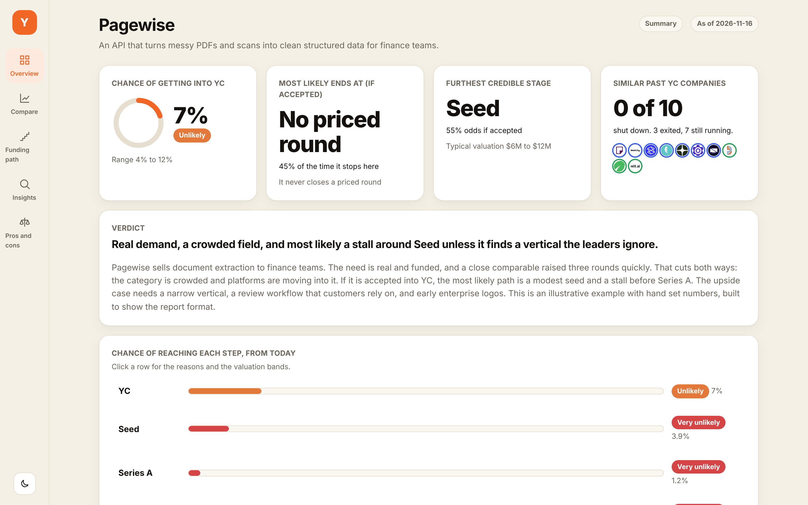
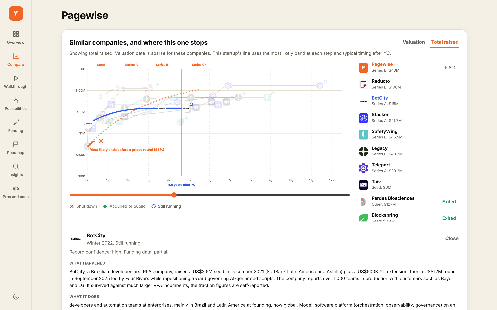
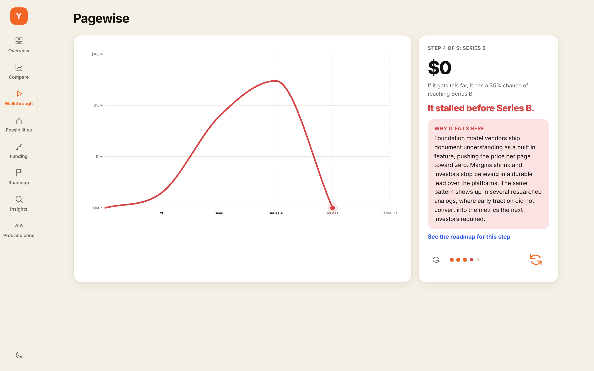
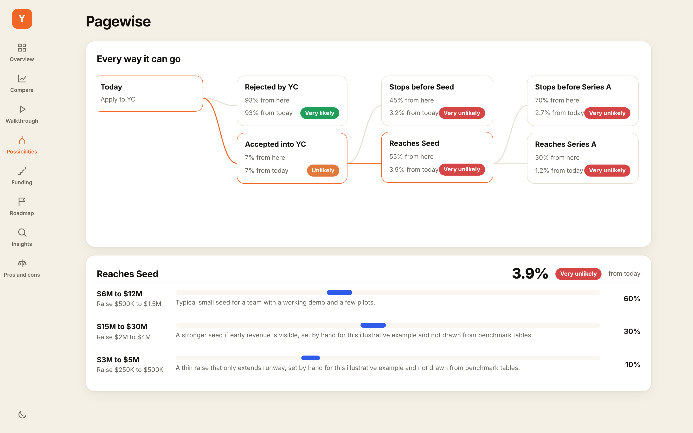

<p align="center">
  
</p>

<h1 align="center">Will I Raise</h1>

<p align="center">
  A Claude Code skill that tells you your odds of getting into Y Combinator and raising each round, using every past YC company as the evidence.
</p>

<p align="center">
  
  
  
</p>

## What it does

Describe your startup to Claude and ask whether you will raise. The skill returns the chance of getting into YC, then the odds of reaching Seed, Series A, Series B and Series C or later, with a likely raise and valuation for each and a paragraph on why it fails at each step. It also finds startup ideas and names, and scores a name.

It does this by comparing you with the 6,399 companies in the public YC directory. Each one was researched for its timeline, funding rounds, founders, competitors at the time it started, how hard it was to build, why it won or failed, and how strong its name was. Where the data is missing, the answer says so.

Four skills ship in `.claude/skills/`:

- **Evaluator.** Give it a startup. You get a short text answer and one standalone `report.html`.
- **Creator.** Finds one startup idea and attacks it with an Investor, a Doubter and a Judge until the Judge would invest.
- **Name creator.** Makes and scores startup names and rates the brand. The other two call it.
- **Extractor.** Built the dataset. You only need it to refresh the data.

## Screenshots

<p align="center">
  
</p>

<table>
  <tr>
    <td width="50%"><br><sub>Compare: similar YC companies on one timeline. Click one to highlight it, drag to see who had died by then.</sub></td>
    <td width="50%"><br><sub>Walkthrough: press the arrow and the startup rises or crashes at each step, using the evaluation's odds.</sub></td>
  </tr>
  <tr>
    <td width="50%"><br><sub>Possibilities: a tree of every way it can go, with the odds on each branch.</sub></td>
    <td width="50%"><br><sub>Roadmap, in dark mode: what to do to reach each step, and how you know it worked.</sub></td>
  </tr>
</table>

The screenshots show an illustrative example (a made up startup called Pagewise) in `evaluations/example-pagewise/`. Its probabilities are set by hand to show the format and are not calibrated. The ten comparison companies on its chart are real researched YC records.

The Funding tab also has a raise calculator. Type how much you want to raise and the valuation cap, for example 50K on a 1M cap, and it shows the share of the company you sell (5% in that case) and where your cap sits against the seed range in the report.

## Technical details

| Part | Where |
|---|---|
| Skills | `.claude/skills/` (`yc-startup-evaluator`, `yc-startup-creator`, `yc-name-creator`, `yc-logo-creator`, `yc-knowledge-extractor`) |
| Company records | `data/enrichment/<slug>.json`, schema in `docs/schema.md` |
| Directory snapshot | `data/raw/yc_all.json`, `data/companies.csv` |
| Knowledge files and tables | `knowledge/` and `knowledge/tables/` |
| Backtest | `knowledge/backtest.md`, `evaluations/backtest-*` |
| Name features | `scripts/name_features.py`, `data/name_features.csv`, `knowledge/tables/name_outcomes.csv` |
| Evaluation input and render | `scripts/evalcore.py`, `scripts/render_eval.py`, `scripts/check_eval.py` |
| HTML report | `scripts/render_html.py`, `scripts/report_template.html` |
| Logo studio | `python3 -I scripts/build_logo_studio.py --name "Acme"` builds one HTML file with 100 logo options and PNG export (research in `knowledge/logo_patterns.md`) |
| Landing page | `site/index.html` (one file, open it in a browser; images in `site/img/`) |
| Settings | `config.json` |

Rules the data follows:

- Unknown is `null`, never zero. Each record states how complete its funding data is, and base rates report a lower, known-only and upper range.
- Every fact is dated. Competitors are recorded as of the YC batch, not as of today.
- A round reported by a single database or outlet is recorded with its source and flagged in `notes` as resting on one source.
- Python only, standard library only. Run scripts as `python3 -I scripts/<name>.py`.

The HTML report has eight tabs: Overview, Compare, Walkthrough, Possibilities, Funding, Roadmap, Insights, and Pros and cons. It is one file with no dependencies. Data, styles, scripts and company logos are embedded. Logos are downloaded once from the public YC directory and cached in `data/logo_cache/`. If a logo cannot be fetched, the page shows a letter badge.

## How the data was built

1. **Research.** The extractor skill worked through the directory in waves of subagents, 8 companies per shard, calibration sample first (about 10% of every batch, picked by a fixed hash, so base rates are not built from hand picked winners). Each company is one JSON file in `data/enrichment/`.
2. **Audit.** Independent agents re-opened the cited sources for samples from every wave and the findings were corrected. Results are in `knowledge/audit_log.md`.
3. **Derive.** Scripts turn the records into base rates and benchmark tables, and six knowledge files are written from them.
4. **Finalize and backtest.** The knowledge is copied into each skill's `references/` folder, and the evaluator was tested on six calibration companies as if it were their batch date. Findings are in `knowledge/backtest.md`.

## Status and limits

Coverage is in `knowledge/coverage.md`. Every company in the directory was researched except one, marked unresearchable with a reason. Many records have thin funding data, because small and old companies leave little public trace. The last audit of 36 fresh records found a clear error or a missing sourced fact in 9.4 percent of 245 fields checked (the bar was 10 percent); the sample is small, so treat that as a rough measure. `scripts/check_complete.py` is the gate for whether the dataset counts as finished, and `knowledge/audit_log.md` records how accurate the audits found it.

- The evaluator's odds are calibrated judgments anchored on past companies, not statistical predictions. Past YC companies are survivors of a selection process.
- The backtest covers six companies, so it shows direction and not measured error. It found the evaluator too pessimistic about niche sounding B2B companies.
- Funding amounts and valuations are often not public. On the comparison chart, valuation data is sparse, so it defaults to total raised when fewer than three companies have a reported valuation.
- Branding evidence is thin for small companies. Most have no press about their own brand, so name origins are mostly `null`.
- Name statistics are confounded with industry and era. They help catch outliers and do not pick winners.

## How to start

You need Python 3.9 or newer and [Claude Code](https://claude.com/claude-code).

```bash
git clone https://github.com/edison16a/yc-startup-life
cd yc-startup-life
claude
```

Then ask in plain words:

- "Will I raise? My startup is ..." runs the evaluator and gives you the text answer plus `report.html`.
- "Find me a startup idea." runs the creator.
- "Name my startup" or "Is this a good name: ..." runs the name creator.

To open a report, double click `evaluations/<name>/report.html`. To refresh the dataset, ask Claude to run the extractor skill; it resumes from the files on disk.

## License

MIT. See `LICENSE`.
