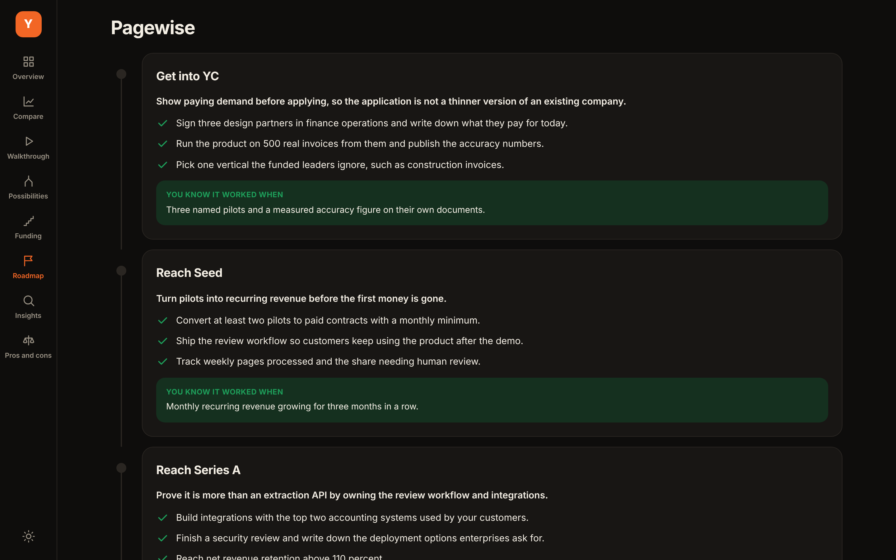

<p align="center">
  
</p>

<h1 align="center">Startup Life</h1>

<p align="center">
  Claude Code skills that research every past Y Combinator company, then evaluate startups, create new ones and name them.
</p>

<p align="center">
  
  
  
</p>

## What it is

Startup Life is a set of four Claude Code skills built on a researched dataset of all 6,399 companies in the public YC directory. For each company it records the timeline, every funding round it can source, the founders, who the competitors were at the time of founding, how hard the product was to build, why it won or failed, and how strong its name and brand were.

On top of that data:

- **Evaluator.** Give it a startup. It returns the chance of getting into YC, then the odds of reaching Seed, Series A, Series B and Series C or later, with a raise and valuation range for each, and a paragraph on why it fails at each step. You get a short text answer and one standalone HTML report.
- **Creator.** Finds one startup idea and attacks it with an Investor, a Doubter and a Judge until the Judge would invest.
- **Name creator.** Makes and scores startup names, and rates the brand. The evaluator and creator both call it.
- **Extractor.** Does the research that feeds the other three.

The numbers are anchored on past YC companies, not gut feel. Where data is missing, the output says so.

## Screenshots

<p align="center">
  
</p>

<table>
  <tr>
    <td width="50%"><br><sub>Compare: similar YC companies on one timeline. Click one to highlight it, drag to see who had died by then.</sub></td>
    <td width="50%"><br><sub>Walkthrough: press the arrow and the startup rises or crashes at each step, using the evaluation's odds.</sub></td>
  </tr>
  <tr>
    <td width="50%"><br><sub>Possibilities: a tree of every way it can go, with the odds on each branch.</sub></td>
    <td width="50%"><br><sub>Roadmap, in dark mode: what to do to reach each step, and how you know it worked.</sub></td>
  </tr>
</table>

The screenshots show an illustrative example (a made up startup called Pagewise) in `evaluations/example-pagewise/`. Its probabilities are set by hand to show the format and are not calibrated. The ten comparison companies on its chart are real researched YC records.

## How it works

1. **Extract.** `yc-knowledge-extractor` works through the directory in waves of subagents, one shard of 8 companies each, calibration sample first (about 10% of every batch, picked by a fixed hash, so base rates are not built from hand picked winners). Each company becomes one JSON file in `data/enrichment/`.
2. **Audit.** Independent agents re-open the cited sources for a sample of every wave. Results go in `knowledge/audit_log.md`.
3. **Derive.** Scripts turn the records into base rates and benchmark tables. Six knowledge files (patterns, failure modes, YC acceptance, stage benchmarks, incumbents and complexity, naming) are written from them.
4. **Finalize.** The distilled knowledge is copied into each skill's `references/` folder, and a completeness gate (`scripts/check_complete.py`) decides whether the job is done.
5. **Use.** The evaluator, creator and name creator run on top. The evaluator forecasts with `scripts/evalcore.py`, which computes cumulative odds and labels from the agent's conditional probabilities and rejects reports whose numbers drift from their inputs.

## Technical details

| Part | Where |
|---|---|
| Skills | `.claude/skills/` (`yc-knowledge-extractor`, `yc-startup-evaluator`, `yc-startup-creator`, `yc-name-creator`) |
| Company records | `data/enrichment/<slug>.json`, schema in `docs/schema.md` |
| Directory snapshot | `data/raw/yc_all.json`, `data/companies.csv` |
| Name features | `scripts/name_features.py`, `data/name_features.csv`, `knowledge/tables/name_outcomes.csv` |
| Evaluation input and render | `scripts/evalcore.py`, `scripts/render_eval.py`, `scripts/check_eval.py` |
| HTML report | `scripts/render_html.py`, `scripts/report_template.html` |
| Settings | `config.json` |

Rules the data follows:

- Unknown is `null`, never zero. Each record states how complete its funding data is, and base rates report a lower, known-only and upper range.
- Every fact is dated. Competitors are recorded as of the YC batch, not as of today.
- Figures seen only in a search snippet or a single aggregator go in `notes` as unverified. They are not recorded as rounds.
- Python only, standard library only. Run scripts as `python3 -I scripts/<name>.py`.

The HTML report has eight tabs: Overview, Compare, Walkthrough, Possibilities, Funding, Roadmap, Insights, and Pros and cons. It is one file with no dependencies. Data, styles, scripts and company logos are embedded. Logos are downloaded once from the public YC directory and cached in `data/logo_cache/`. If a logo cannot be fetched, the page shows a letter badge.

## Status and limits

The extraction is large and still running. At about 14 tool calls per company, the full job is on the order of 90,000 tool calls. Progress is in `knowledge/progress.md` and `knowledge/coverage.md`, and `scripts/check_complete.py` lists what is left.

- The evaluator's odds are calibrated judgments anchored on past companies, not statistical predictions. Past YC companies are survivors of a selection process.
- Funding amounts and valuations are often not public. On the comparison chart, valuation data is sparse, so it defaults to total raised when fewer than three companies have a reported valuation.
- Web search has a per turn budget of 200 calls shared by all agents, which caps how many shards one session can finish.
- Branding evidence is thin for small companies. Most have no press about their own brand, so name origins are mostly `null`.
- Name statistics are confounded with industry and era. They help catch outliers and do not pick winners.

## Start the project

You need Python 3.9 or newer and [Claude Code](https://claude.com/claude-code).

```bash
git clone https://github.com/edison16a/yc-startup-life
cd yc-startup-life
claude
```

Say "Begin." The agent runs `python3 -I scripts/check_complete.py`, then carries on with the extractor until it passes. It resumes from the files on disk, so you can stop and start.

Once the data exists:

- "Evaluate this startup: ..." runs the evaluator and gives you the text answer plus `report.html`.
- "Find me a startup idea." runs the creator.
- "Name my startup" or "Is this a good name: ..." runs the name creator.

To open an existing report, double click `evaluations/<name>/report.html`.

## License

MIT. See `LICENSE`.
